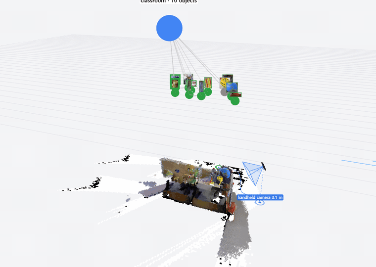

# 온디바이스 AI 기말 프로젝트 — 물체 공간 기억

손에 든 USB 카메라로 공간을 훑으면, 라즈베리파이 5 + DEEPX DX-M1 보드 안에서 본 물체를 **경량 3D 씬그래프**로 기억한다.
나중에 "텀블러"를 검색하면 3D 좌표, 주변 관계(책상 위·노트북 옆), 마지막으로 본 시각과 사진을 돌려준다. 모든 계산은 보드 안에서 하고, LLM 은 쓰지 않는다.



*TUM RGB-D fr3/long_office_household 를 실제 속도로 재생(2배속 GIF). 아래 = 3D 점 지도와 손에 든 카메라(파란 원뿔)·궤적, 가운데 = 물체 노드층(사진·상태색), 위 = 방 노드(SigLIP 2 로 정한 방 종류·물체 수), 회색 선 = 방→물체 엣지. 분할 COCO YOLO26s-seg, 깊이는 Kinect 실측(딥러닝 깊이 배율 보정 전 기준판). 고화질 [cover-graph.mp4](docs/cover-graph.mp4).*

## 흐름

```
USB 카메라 30fps ─▶ ① 카메라 포즈 추적
                         │ 키프레임
                         ▼
                   ② NPU: YOLO-seg ─ 깊이 추정 ─ CLIP 임베딩
                         ▼
                   ③ 3D 매핑 (CPU): 마스크 + 깊이 → 물체 3D 점 → 같은 물체 합치기
                         ▼
                   ④ 씬그래프 저장 → 검색 + 웹 뷰어
```

## 하드웨어

| 부품 | 사양 |
|---|---|
| 보드 | Raspberry Pi 5 (8 GB) |
| NPU | DEEPX DX-M1 (4 GB) |
| 카메라 | USB RGB 카메라 (깊이·IMU 없음), 손에 들고 움직임 |

## 폴더

| 폴더 | 내용 | 담당 |
|---|---|---|
| `docs/` | 설계·일정·측정 결과 ([plan.md](docs/plan.md)) | 같이 |
| `train/` | 분할 모델 학습 (PC). `train/ObjectSAM` = YOLO26s-seg C++/CUDA 학습기(원본 juyoung020/ObjectSAM 을 기록째로 합침, [docs/YOLO26_PORT.md](train/ObjectSAM/docs/YOLO26_PORT.md)) | A |
| `compile/` | ONNX → `.dxnn` 변환 설정, 양자화 보정 이미지 목록 | A |
| `board/` | 보드에서 도는 코드: 카메라, 위치 추적, NPU 실행, 3D 매핑, 씬그래프, 검색 | B |
| `viewer/` | 3D 지도·씬그래프 웹 뷰어 | B |
| `tools/` | 속도·정확도 측정 스크립트 | 같이 |
| `models/` | `.pt` `.onnx` `.dxnn` (git 밖) | |
| `data/` | 촬영 영상·라벨·기억 저장본 (git 밖) | |

A = 모델·컴파일러, B = 보드·앱 (수업 지정 분담).

## 보드 접속

```bash
ssh a2024130045@kau
source ~/dx-all-suite_my/dx-runtime/venv-dx-runtime/bin/activate
```

측정 방법은 `Desktop\kau-2026-2\온디바이스 AI\기말프로젝트\벤치마킹 가이드.md`.

## 규칙

- 경로에 공백·한글을 넣지 않는다 (DX 툴체인이 깨짐). 그래서 이 폴더가 `C:\ondevice` 다.
- 가중치·데이터는 git 에 넣지 않는다.
