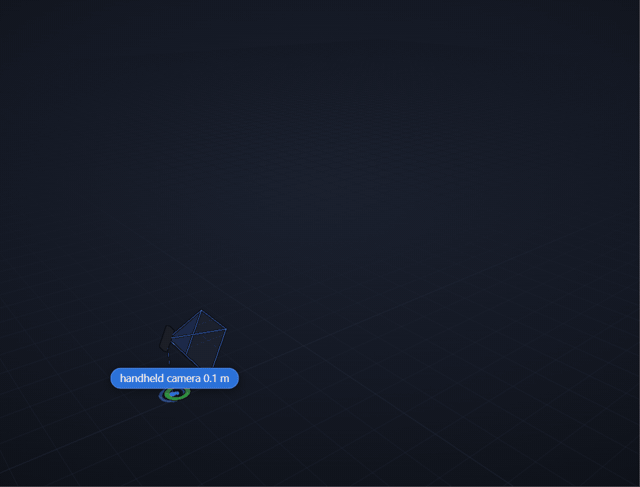

# 물체 공간 기억 — 손카메라로 훑으면 보드가 방을 3D로 기억한다

[변경 기록(CHANGELOG)](CHANGELOG.md)

RealSense D435 깊이 카메라를 손에 들고 방을 한 바퀴 훑으면, 라즈베리파이 5와 DEEPX DX-M1 NPU 보드가 다음 세 가지를 실시간으로 만들어 기억합니다.

- **3D 지도:** 사진 텍스처를 입힌 표면 지도, 3D 점 지도, 바닥 점유 지도
- **물체 목록:** 무엇이 어디에 있는지(3D 위치, 사진, 마지막으로 본 시각)
- **씬그래프:** 방 → 물체, 물체 ↔ 물체 관계(위·옆)

계산은 모두 보드 안에서 합니다. 카메라 위치는 RTAB-Map(SLAM)이, 물체 분할은 NPU가, 지도·물체·씬그래프는 Rust 프로그램 `memmap`이 맡습니다.



*공개 영상(TUM RGB-D 사무실)을 넣은 모습. 아래는 3D 지도와 손에 든 카메라(파란 원뿔), 가운데는 찾은 물체, 위는 방입니다. 고화질: [cover-slam.mp4](docs/cover-slam.mp4)*

## 구성

```
D435(컬러 + 깊이) → rtab_bridge(C++, RTAB-Map 위치 추적·루프 클로저) → memmap(Rust) → sgview(뷰어, 브라우저)
                                                   NPU 물체 분할 ┘
```

- **위치:** RTAB-Map이 장면마다 카메라 위치를 구하고, 한 바퀴 돌아 아까 본 곳을 알아보면(루프 클로저) 지나온 위치를 다시 맞춥니다. 자세한 형식은 [docs/bridge.md](docs/bridge.md).
- **표면 지도:** 20초 단위 TSDF 서브맵으로 쌓습니다. 루프 클로저로 위치가 고쳐지면 서브맵을 통째로 옮겨 약 0.1초 만에 지도가 바로잡힙니다. 표면에는 장면 사진을 입힙니다(사진 경계는 밝기를 맞춰 섞음).
- **점 지도:** Potree 방식(옥트리 단계별 상세도 + 둥근 점 + EDL 음영)으로 저장해, 뷰어는 화면에 필요한 만큼만 받아 그립니다.
- **실시간:** 처리가 밀리면 쌓인 장면을 건너뛰고 최신 장면부터 처리합니다(위치 정보는 버리지 않음). 지도 작업·텍스처·다시 쌓기는 본 스레드 밖에서 돕니다.

## 되는 것

- 물체 찾기(COCO 80종: 의자·컵·노트북·책 …) — 보드 NPU
- 카메라 위치 추정과 루프 클로저 — RTAB-Map(BRIEF 특징 + GTSAM 최적화)
- 텍스처 표면 지도, 3D 점 지도, 물체 기억(옮겨짐·사라짐 표시)
- 방 나누기와 방 종류(물체 구성으로: 사무실·주방·거실 …), 방↔물체·물체↔물체 연결
- 보드 실시간(NPU 코어 여럿에 장면을 함께 올림), PC·폰·보드 화면 브라우저 뷰어(High/Low 화질)

## 성능 (보드 실측, 공개 영상을 실제 속도로 재생)

| 항목 | 값 |
|---|---|
| 지도 갱신 | 약 11 장면/초, 지연 0.2 초 안팎(최대 0.25–0.35 초) |
| 물체 분할 | 받은 장면의 90 % 이상(초당 약 10 번) |
| 카메라 위치 오차 | 책상 4 cm, 사무실 3 cm, 58 m 복도 24 cm |

측정 방법과 기록은 [docs/performance_log.md](docs/performance_log.md)에 있습니다.

## 빠른 시작 — PC(Windows·WSL)

보드 없이 PC에서 같은 과정을 돌려 볼 수 있습니다.

**1. 모델 받기** — `models/` 폴더에 둡니다.

| 파일 | 하는 일 | 받는 곳 |
|---|---|---|
| `yolo26s-seg.onnx` | 물체 찾기(분할) | Hugging Face `prithivMLmods/YOLO26-ONNX` |

**2. 시험 영상 받기** — [TUM RGB-D](https://cvg.cit.tum.de/data/datasets/rgbd-dataset/download)에서 영상을 받아 `data/` 아래에 풉니다(D435 로 찍은 사무실 영상 `data/d435/rgbd_dataset_freiburg3_office_sync` 와 같은 TUM 형식). 쓴 데이터 전체 목록은 [data/README.md](data/README.md).

**3. 빌드하고 실행** — `rtab_bridge` 빌드(RTAB-Map·librealsense)는 [docs/bridge.md](docs/bridge.md)와 [docs/board_bridge.md](docs/board_bridge.md).

```bash
cargo build --release --features directml --manifest-path pipeline/Cargo.toml
cargo build --release --manifest-path viewer/sgview/Cargo.toml

# TUM 영상 → RTAB-Map → memmap(텍스처 표면 + 점 지도)
rtab_bridge --tum data/d435/rgbd_dataset_freiburg3_office_sync --config docs/rtabmap_pi.ini \
  | pipeline/target/release/memmap --stream - --every 2 --surface --points --seg models/yolo26s-seg.onnx \
      --max-depth 3.5 --out data/memory/office

# 다른 창에서 뷰어 → 브라우저로 http://127.0.0.1:8091
viewer/sgview/target/release/sgview data/memory/office --port 8091 --bind 127.0.0.1
```

## 보드에서 실행 — Raspberry Pi 5 + DX-M1 + D435

```bash
cargo build --release --no-default-features --features dxrt,cam --manifest-path pipeline/Cargo.toml
M=~/dx-all-suite_my/workspace/res/models

# D435 → RTAB-Map → memmap(실시간)
rtab_bridge --realsense --config docs/rtabmap_pi.ini --send-every 2 \
  | pipeline/target/release/memmap --stream - --every 1 --live 1 --surface --points \
      --seg $M/yolo26-s-seg_640x640.dxnn --max-depth 3.5 --out data/memory/live

# 뷰어: 같은 네트워크의 PC·폰에서 http://<보드 주소>:8091
sgview data/memory/live --port 8091 --bind 0.0.0.0
```

- **보드 화면에서 볼 때:** `chromium --password-store=basic http://127.0.0.1:8091`(키링 암호 창이 브라우저를 막지 않게). 보드 GPU에서는 뷰어가 자동으로 Low 화질로 시작합니다.
- **NPU는 한 번에 한 프로그램만** 쓰세요. 두 개가 동시에 쓰면 NPU 연결이 끊겨 재부팅해야 할 수 있습니다. 새로 돌리기 전에 `pkill -f 'memmap --'`.

## 주요 옵션 (memmap)

| 옵션 | 뜻 |
|---|---|
| `--stream -\|<파일>` | `rtab_bridge` 장면 스트림 입력(표준입력 또는 남겨 둔 파일) |
| `--surface` / `--points` | 텍스처 표면 지도 / 3D 점 지도(둘 다 켤 수 있음) |
| `--rebuild-every S` / `--no-rebuild` | 루프 클로저 뒤 다시 쌓기 간격(초, 기본 5) / 끄기 |
| `--no-drop` | 밀려도 장면을 버리지 않음(재생 결과를 늘 같게) |
| `--threads auto\|none\|…` | 스레드 우선순위·코어 배치(기본 auto; 역할 main · reader · pts · tex · rebuild · writer · infer) |
| `--npu-jobs K` | 스트림 분할 장면을 NPU 에 K 장까지 함께 올림(NPU 코어 여럿이 나눠 돎, 기본 4, `1` 은 한 장씩) |
| `--seg <모델>` / `--conf 0.35` | 물체 분할 모델 / 물체로 인정할 확신도 |
| `--max-depth` | 지도에 넣을 최대 거리(m) |
| `--every N` | 받은 장면 N장마다 처리 |
| `--live 1` / `--loop` | 실제 속도로 재생하며 뷰어에 계속 갱신 / 끝나면 반복 |
| `--out <폴더>` | 기억을 저장할 폴더(뷰어가 이 폴더를 읽음) |

## 뷰어 보는 법

- **마우스:** 끌면 돌리기, 휠은 확대·축소, 오른쪽 끌기는 이동.
- **오른쪽 위 도구줄:** `Fit`(전체 맞추기) · `Top`(위에서 보기) · `Demo`(천천히 자동 회전) · `High/Low`(화질) · `Settings`(설정 패널).
- **화질:** High는 PC용(점 섞기로 가까이서도 면처럼 보임), Low는 보드·폰용입니다. Low는 돌리는 동안 절반 해상도로 가볍게 그리고 멈추면 0.2초 뒤 원래 화질로 다시 그립니다.
- **화면 구성:** 텍스처 표면 또는 색 점이 3D 지도, 파란 원뿔이 지금 카메라(위치를 놓친 동안은 빨간색), 위쪽 층이 물체와 방 노드입니다.
- **물체 색:** 초록 = 지금 보임, 주황 = 옮겨짐, 회색 = 그 자리에서 사라짐.
- **설정 패널에서 켜고 끄기:** `Surface map`(표면), `3D map points`(점 지도), `Object name labels`(이름표), `Show graph layers`(물체·방 층), `Depth fog`(거리 안개) 등.
- **시연할 때:** `Follow the handheld camera (behind)`를 켜면 시점이 손카메라 뒤에서 따라갑니다(마우스로 돌리면 꺼짐).

설명 문서: 연결·서브맵·루프 클로저는 [docs/bridge.md](docs/bridge.md), 뷰어 세부는 [viewer/sgview/README.md](viewer/sgview/README.md).
