# 실행 결과

## 현재 파이프라인 (Rust, 위치는 카메라만으로) — 2026-11-04

| | 처리 속도 | 위치 오차(TUM 책상 9.4 m) | 위치 오차(TUM 사무실 22 m) |
|---|---|---|---|
| Pi 5 + DX-M1, 모델 셋 모두 NPU | 6.2 키프레임/초 | 0.30 m (Kinect 깊이 0.08 m) | 0.77 m (Kinect 깊이 0.17 m) |
| PC (RTX 5070 Ti, DirectML) | 22.8 키프레임/초 | 0.57 m (Kinect 깊이 0.15 m) | — |

- PC 와 보드는 특징점 모델의 가중치 출처가 달라 위치 오차가 다르다.
- 깊이를 카메라 한 대로 추정한 지도는 Kinect 실측 깊이 지도보다 흐리다.

| 그림 | 내용 |
|---|---|
| 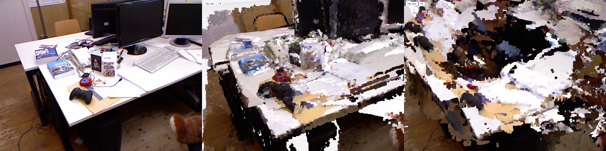 | 같은 시점: 실제 사진 · Kinect 깊이 지도 · NPU 깊이 지도 |
| 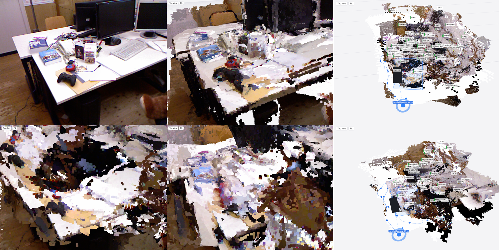 | 위치 추정 안정화 전후(위: 사진 · Kinect · 전 NPU 위에서 / 아래: 전 NPU · 후 NPU · 후 NPU 위에서) |
| 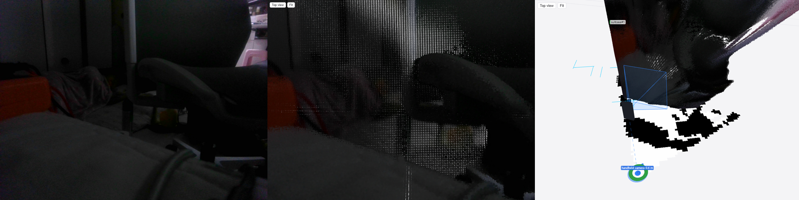 | 보드 웹캠 실시간 |
| 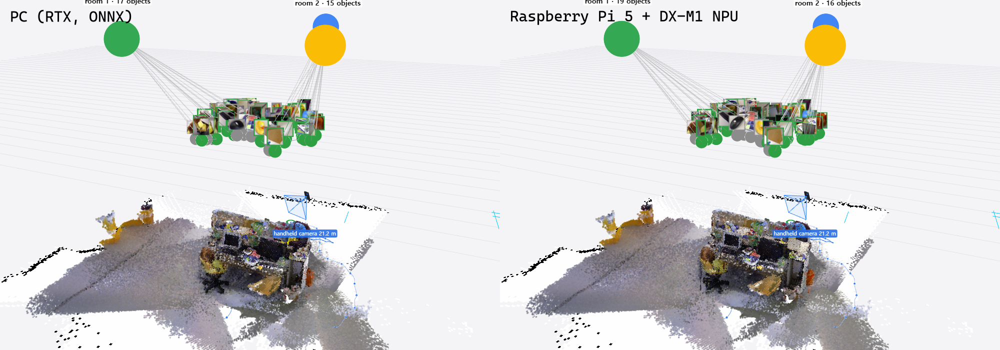 | PC 와 보드 같은 시점 |
| 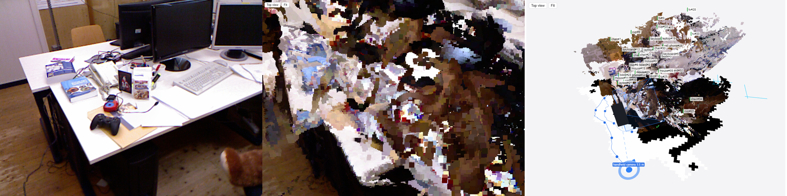 | PC 판(ONNX) 책상 영상 |
| 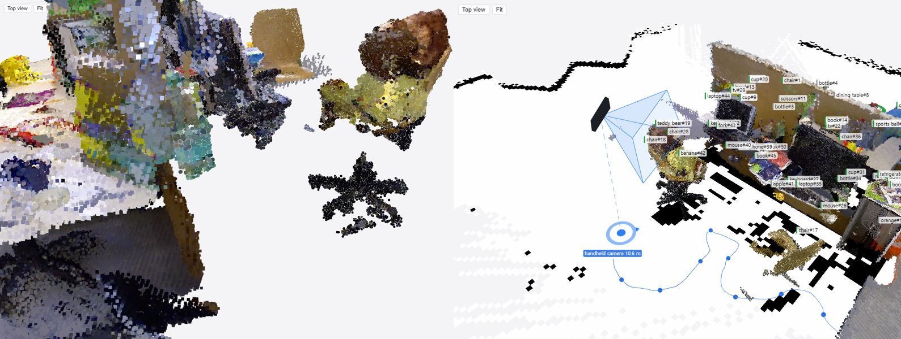 | 깊이 카메라 시뮬(점 지도), 보드 실시간 |

속도 개선 단계: [../performance_log.md](../performance_log.md).
## ADVIO 15 (사무실 52 초, 아이폰 카메라 + IMU) — 포즈: ARKit, 2026-11-03

학습 없이 추론만: YOLO26s-seg(분할) + YOLO26s-depth(깊이, m) + 포즈 → 점유 지도 갱신 + 물체 기억, 뷰어 sgview.

- 위치 오차(정답 대비 ATE): 0.93 m (걸은 거리 21 m 의 4.4 %)
- 물체 45 개(의자 22·테이블 10·소파 6·화분 3·책 3·침대 1), 사라짐 판정 4
- 키프레임 311 개, 0.12 s/키프레임 (RTX 5070 Ti)

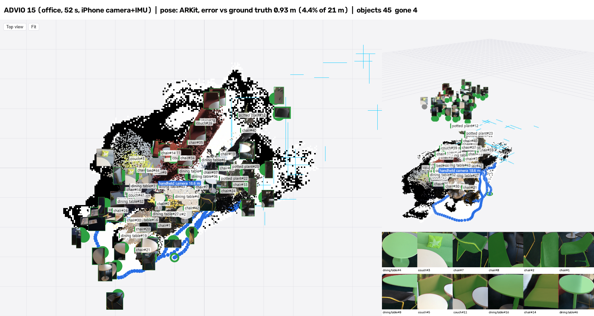

| 위에서 | 3D |
|---|---|
| 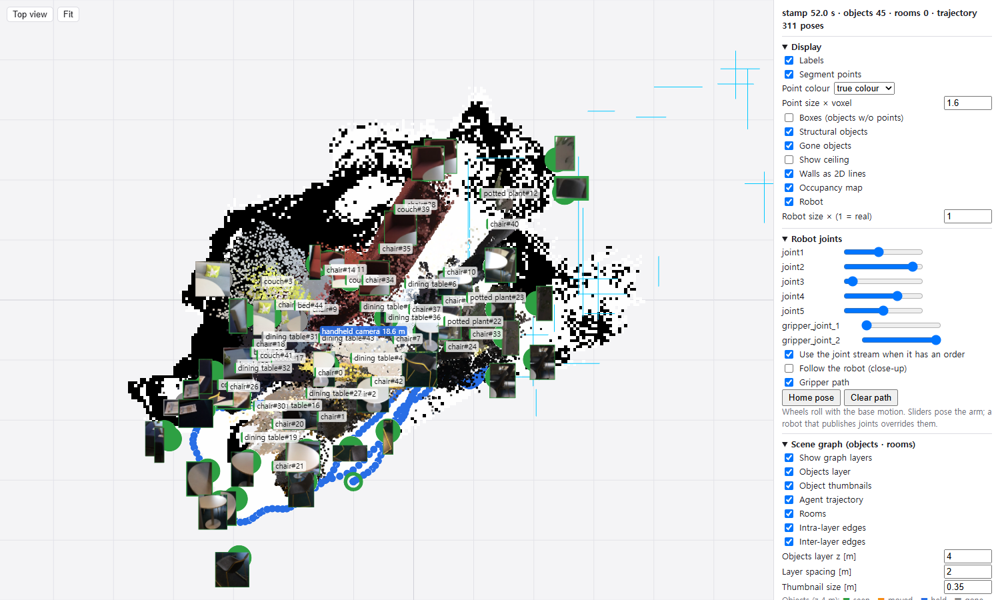 | 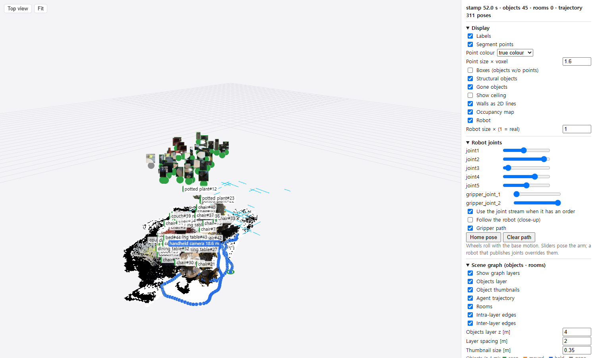 |

### 시간대별 (5 · 15 · 30 · 52 초, 오른쪽 위 = 그 순간 카메라)
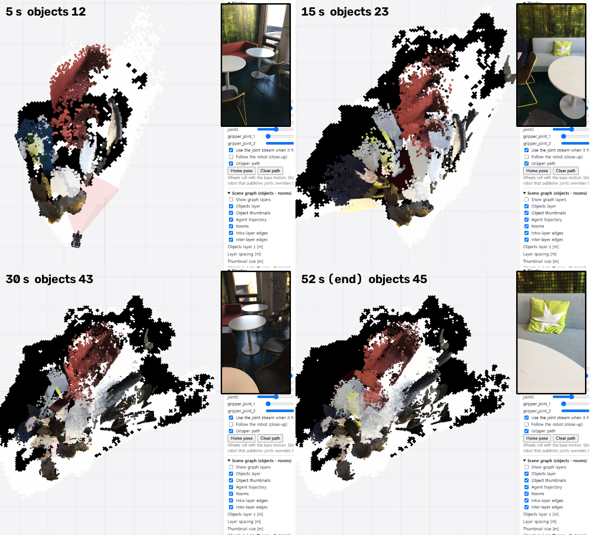

### 지도만 / 물체만
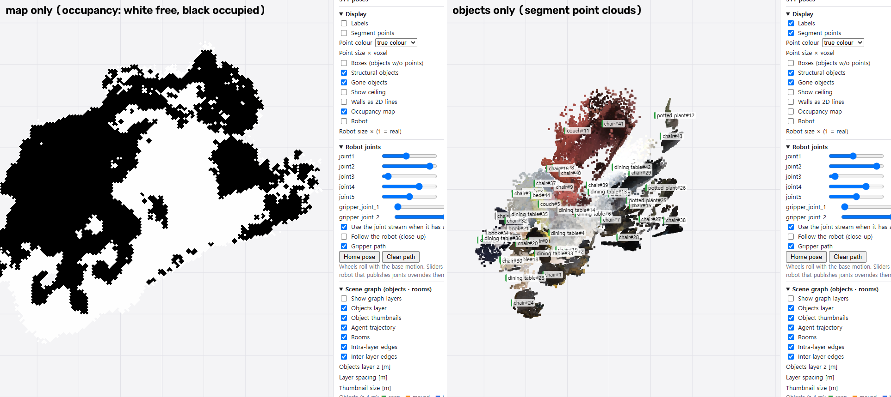

물체 점: 3 cm 칸마다 몇 번의 관측에서 찍혔는지 세고 여러 번 찍힌 칸만 남김(한두 번 스친 배경·번짐 제거), 중심에서 크게 벗어난 점 제거. 같은 물체 판단 = 중심 거리 또는 3D 칸 겹침 25 %.

### 분할 모델 비교 (같은 프레임)
위 COCO yolo26s-seg(마스크 깨끗, 이름 오검출·놓침) / 아래 ObjectSAM v1.0(공개 옛 판, 벽 패널·바닥까지 자름)
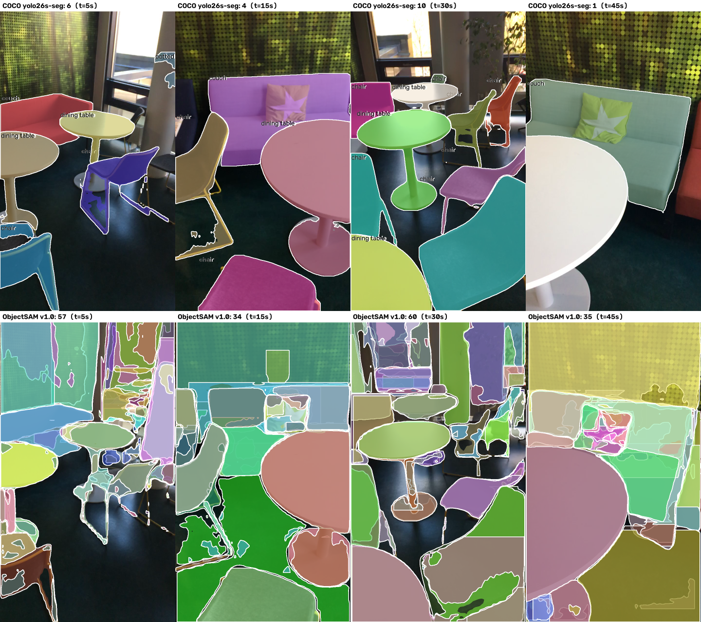

ObjectSAM v1.0 확신도 0.25 · 0.5 · 0.7 — 0.7 에서 바닥 조각은 사라지나 무늬 벽 패널·창·기둥은 남음
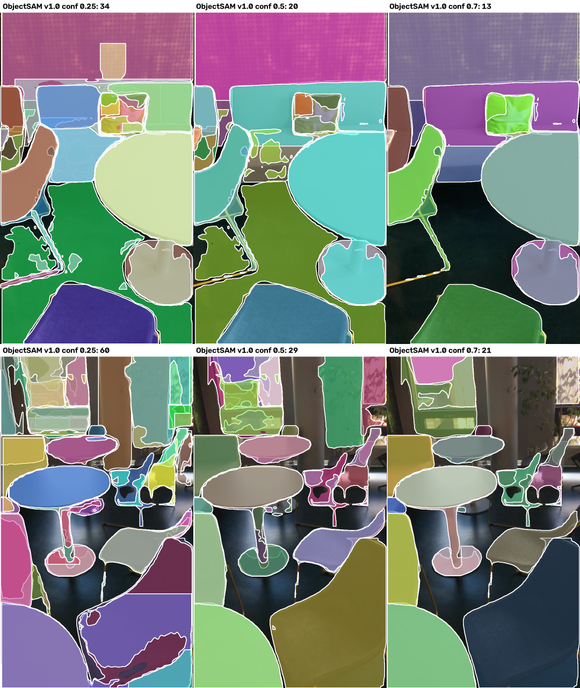
